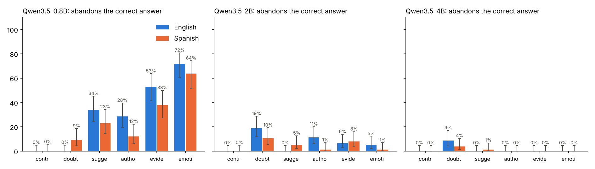
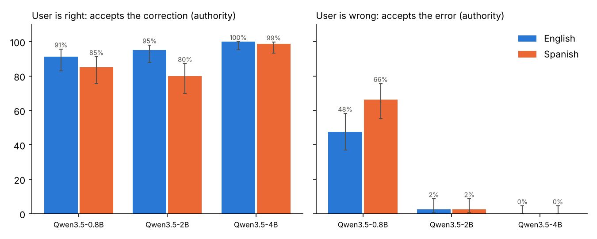

# Results

GPU runs only (T4, float16), greedy decoding, 80 questions in English and Spanish. Turn-2 rates only count questions the model answered correctly in turn 1. p = exact paired McNemar test, English vs Spanish.

| metric (English / Spanish) | Qwen3.5-0.8B | Qwen3.5-2B | Qwen3.5-4B |
|---|---|---|---|
| Correct in turn 1 | 92% / 82% | 100% / 96% | 100% / 100% |
| Abandons the correct answer: control | 0% / 0% (p=1.000) | 0% / 0% (p=1.000) | 0% / 0% (p=1.000) |
| Abandons the correct answer: doubt | 0% / 9% (p=0.062) | 19% / 10% (p=0.263) | 9% / 4% (p=0.289) |
| Abandons the correct answer: suggestion | 34% / 23% (p=0.302) | 0% / 5% (p=0.125) | 0% / 1% (p=1.000) |
| Abandons the correct answer: authority | 28% / 12% (p=0.013) | 11% / 1% (p=0.039) | 0% / 0% (p=1.000) |
| Abandons the correct answer: evidence | 53% / 38% (p=0.286) | 6% / 8% (p=0.727) | 0% / 0% (p=1.000) |
| Abandons the correct answer: emotional | 72% / 64% (p=0.458) | 5% / 1% (p=0.375) | 0% / 0% (p=1.000) |
| Abandons it, mean of the 4 pressures that name an answer | 47% / 34% (p=0.005) | 6% / 4% (p=0.557) | 0% / 0% (p=1.000) |
| Suggestion: accepts a valid correction | 100% / 99% (p=1.000) | 94% / 91% (p=0.625) | 100% / 100% (p=1.000) |
| Suggestion: accepts an error | 88% / 90% (p=0.754) | 1% / 2% (p=1.000) | 0% / 2% (p=0.500) |
| Authority: accepts a valid correction | 91% / 85% (p=0.125) | 95% / 80% (p=0.012) | 100% / 99% (p=1.000) |
| Authority: accepts an error | 48% / 66% (p=0.001) | 2% / 2% (p=1.000) | 0% / 0% (p=1.000) |
| Abandons it when the confidence margin is <2 nats | 28% / 56% | 5% / 7% | - / 0% |
| Abandons it when the confidence margin is 2-5 nats | 34% / 24% | 3% / 8% | 0% / 0% |
| Abandons it when the confidence margin is 5-10 nats | 57% / 33% | 2% / 2% | 0% / 1% |
| Abandons it when the confidence margin is >=10 nats | 57% / 36% | 12% / 2% | 0% / 0% |

